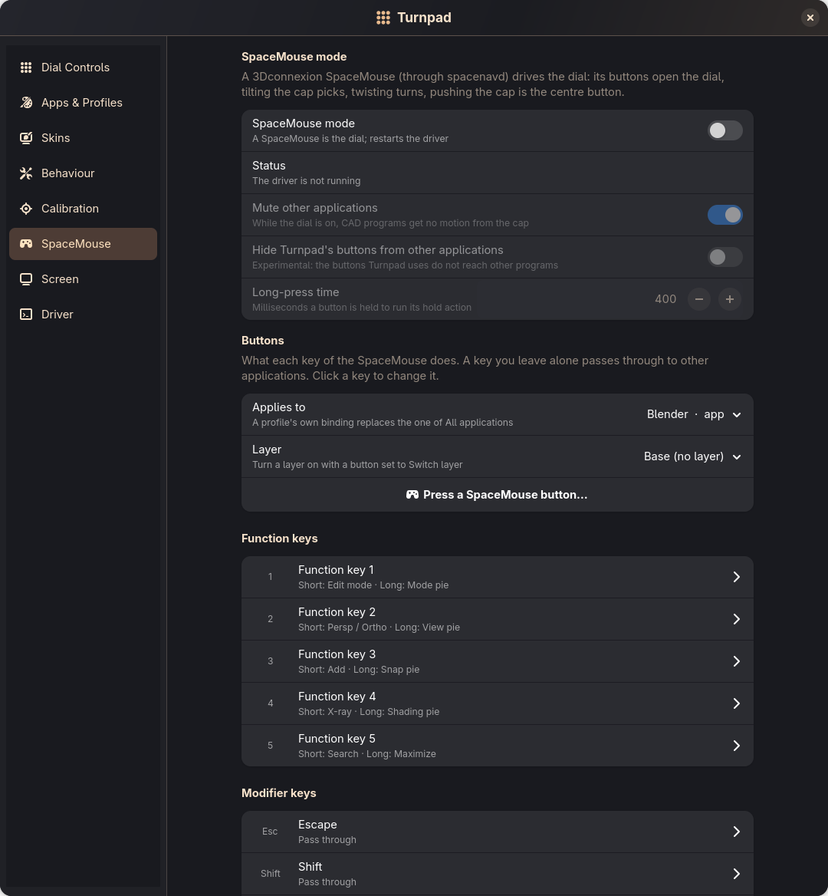
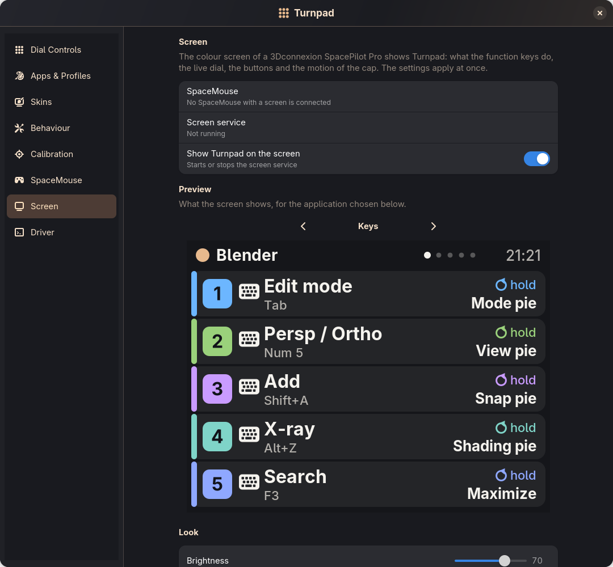
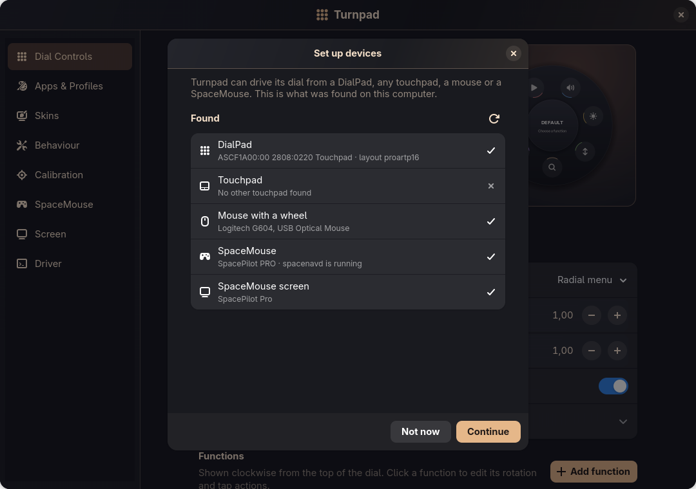
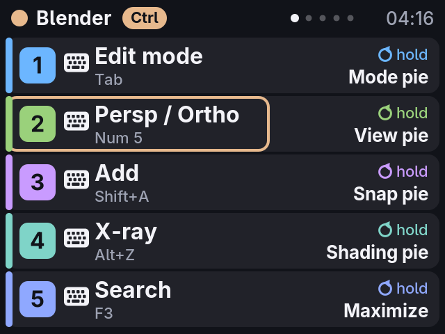
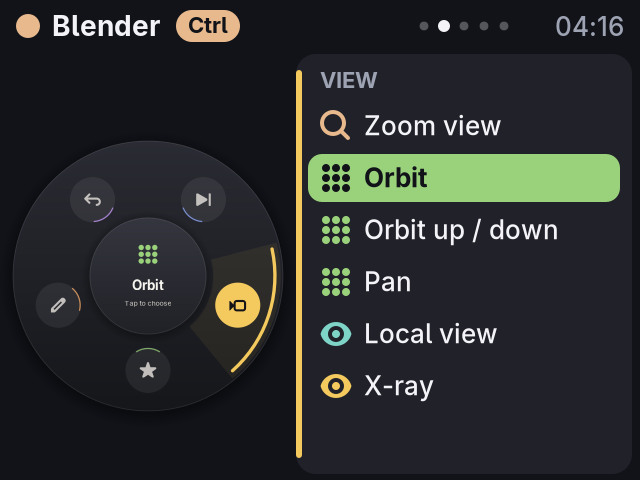
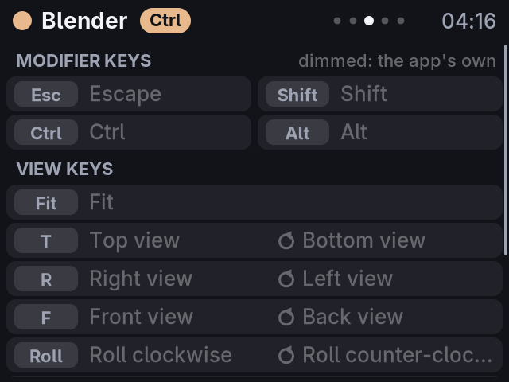
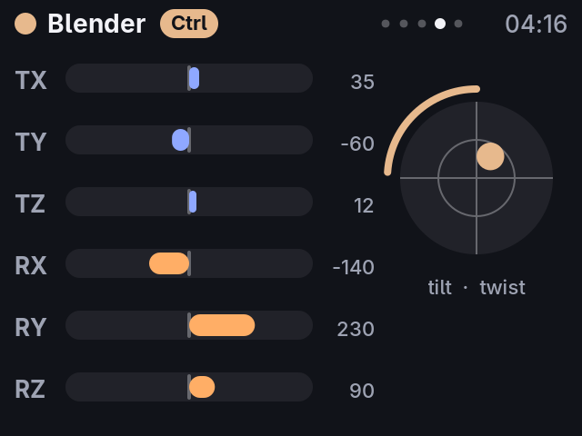
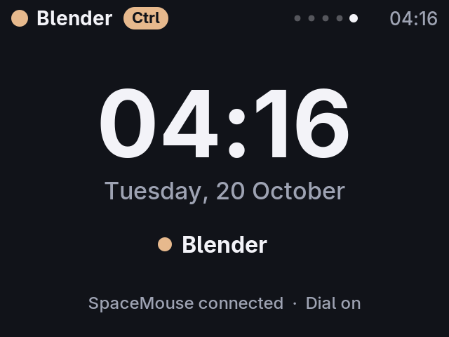

# Gallery

All pictures are painted from the code by `python3 tools/update_previews.py` (see the [README](README.md#screenshots)).

## On-screen dial

The dial in its main states: the radial menu, a level gauge, an endless function and a profile bound to one function.

**Built-in skins.** Five looks to start from; make your own in the skin editor or write it as JSON by hand or with an AI assistant ([SKINS.md](SKINS.md)).

**Shapes.** A skin also sets the outline of the dial and the shape of its tiles, or uses an outline you draw in the editor.

**Groups.** A group opens a straight list of more functions beside the dial, on the side of its sector: turn to move the highlight, tap the centre to choose, hold it to go back. A long list scrolls and keeps the highlight in the middle; a function chosen from a list returns to it when the centre is held.

**Background pictures.** The example skin in [`examples/skins/`](examples/skins/): *Gertie the Dinosaur* by Winsor McCay (1914, public domain, from [Wikimedia Commons](https://commons.wikimedia.org/wiki/File:Gertie_the_Dinosaur_with_her_mouth_open.jpg)) behind a see-through centre and a spiky drawn outline.

## Settings app

| | |
|---|---|
|  |  |
| Functions of a profile, in dial order | Default and application profiles |
|  |  |
| Ready functions and app packs | Colour, icon, live value and actions of a function |
|  |  |
| Guided and manual calibration | Activation, DialPad light and rotation |
|  |  |
| Skins page: gallery, light and dark choice, on-screen dial | Skin editor with a live preview |
|  |  |
| Drawing your own outline | A group: its list as on screen and its functions |
|  |  |
| SpaceMouse: the device, buttons with press and hold actions, layers, cap motion | The SpacePilot Pro's screen: preview, look, power, pages |
|  | |
| First start: what was found and which modes to use | |

## SpacePilot Pro screen

The colour screen of a 3Dconnexion SpacePilot Pro shows Turnpad (`screen/`, user service `asus-turnpad-screen.service`; settings on the *Screen* page; guide: [SPACEMOUSE.md](SPACEMOUSE.md#the-spacepilot-pros-screen)). Pictures drawn by `tools/render_screen_preview.py` with the code that drives the panel; the demo is a Blender profile whose buttons carry labels.

| | |
|---|---|
|  |  |
| Function keys 1–5: the action of the short press and of the long press | The live dial, steered with the screen's keys |
|  |  |
| Every button of the active application (dimmed: the application's own) | Live cap: six axes, tilt and twist |
|  | |
| Clock and status | |
